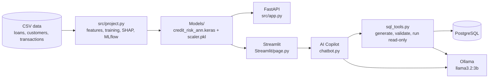
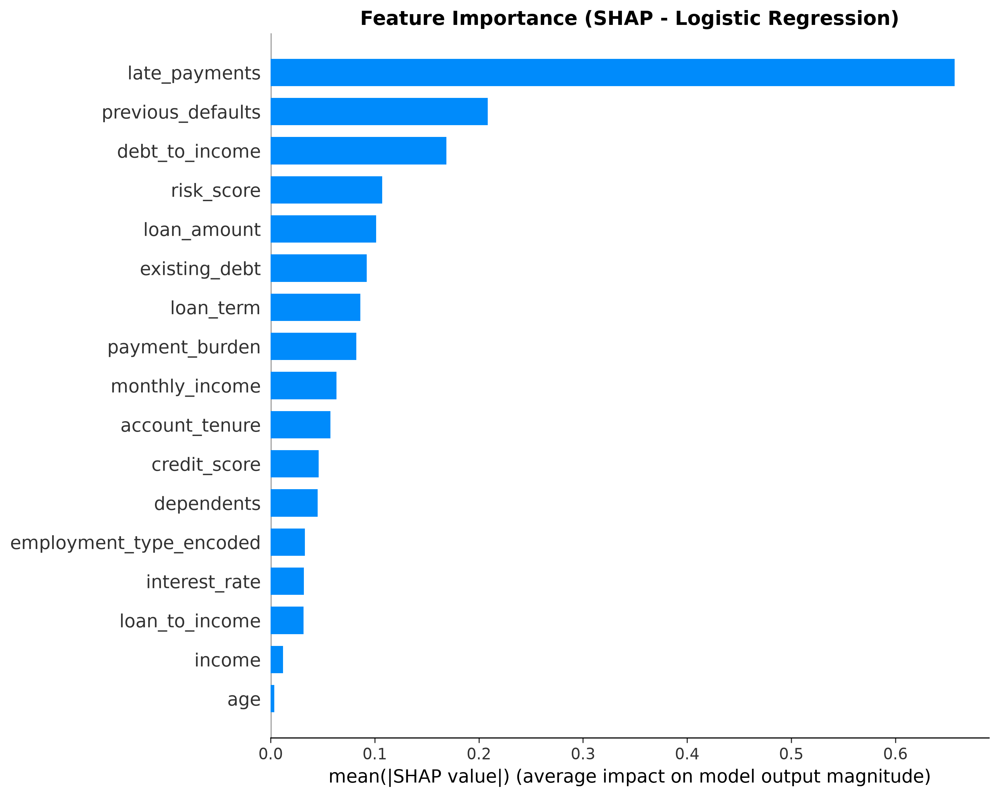
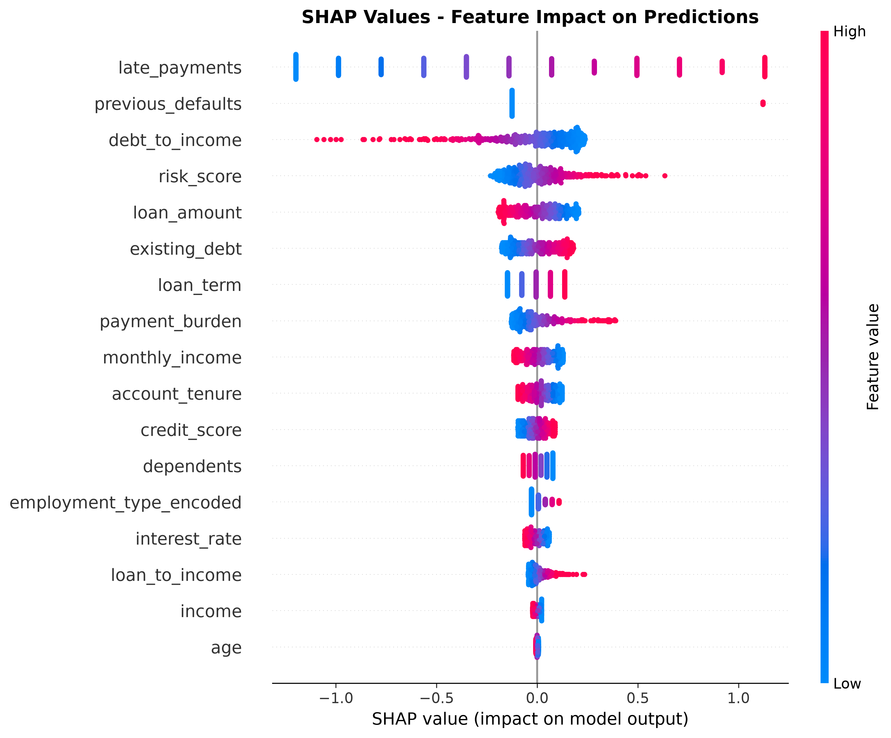

# 🏦 AI Banking Fraud & Credit-Risk Platform

An end-to-end machine-learning project for banking risk. It predicts **loan default risk** from customer and loan data, explains the model with **SHAP**, tracks experiments with **MLflow**, serves predictions through a **FastAPI** service and a **Streamlit** app, and includes an **AI Copilot** that answers questions about the banking database through a validated, read-only natural-language-to-SQL pipeline (**Ollama + PostgreSQL**).


---

## 📌 What is implemented

| Module | Status |
|---|---|
| Loan default / credit-risk model (LR, Random Forest, XGBoost, ANN) | ✅ Implemented |
| SHAP explainability and MLflow experiment tracking | ✅ Implemented |
| FastAPI prediction service (single and batch) | ✅ Implemented |
| Streamlit loan-risk app | ✅ Implemented |
| AI Copilot: natural language → validated read-only SQL (Ollama + PostgreSQL) | ✅ Implemented |
| Transaction feature engineering (`is_night`, `amount_ratio`, `high_amount`) | ✅ Built, not yet used by a model |
| Transaction fraud classifier | 🚧 Planned |

---

## 🏗️ Architecture



---

## 📁 Project structure

```text
AI-Banking-Fraud-Credit-Risk-Platform/
├── Data/                  loans.csv, customers.csv, transactions.csv
├── Models/                credit_risk_ann.keras, scaler.pkl (+ LR / RF / XGBoost pickles)
├── Results/               SHAP plots
├── src/
│   ├── project.py         training pipeline (features, 4 models, SHAP, MLflow)
│   └── app.py             FastAPI service
├── Streamlit/
│   ├── page.py            Streamlit app (entry point)
│   ├── chatbot.py         AI Copilot interface and question routing
│   └── sql_tools.py       text → SQL, validation, read-only execution
├── Sql/
│   └── test_sql.py        checks the PostgreSQL connection
├── Dockerfile, Dockerfile.streamlit, docker-compose.yml
├── requirements.txt            API runtime
├── requirements_streamlit.txt  Streamlit app
├── requirements-train.txt      training (includes requirements.txt)
├── .env.example
└── README.md
```
<!-- VERIFY: keep the Docker line only if those files are up to date with the ANN model and the new requirements files. -->

---

## 🗂️ Dataset

Three tables are used (CSV files in `Data/`, also loaded into PostgreSQL for the Copilot):

| Table | Columns |
|---|---|
| `customers` | customer_id, age, income, employment_type, credit_score, account_tenure, city, dependents |
| `loans` | loan_id, customer_id, loan_amount, loan_term, interest_rate, monthly_income, existing_debt, previous_defaults, late_payments, **default** |
| `transactions` | transaction_id, customer_id, amount, transaction_time, merchant_category, payment_method, location, device_type, is_fraud |

The prediction target is `loans.default` (1 = the customer defaulted).

<!-- Add the data source here: synthetic data generated for this project, or a Kaggle / public link. -->

---

## 🧠 Modelling

### Features (17)

Raw columns plus engineered ratios:

| Feature | Meaning |
|---|---|
| `debt_to_income` | existing debt ÷ monthly income |
| `loan_to_income` | loan amount ÷ annual income |
| `payment_burden` | loan amount ÷ loan term (months) |
| `risk_score` | weighted mix of credit score, debt-to-income, previous defaults and late payments |
| `employment_type_encoded` | employment type as an integer |

### Models compared

Logistic Regression, Random Forest, XGBoost and an ANN (64-32-16-1 with dropout, early stopping and balanced class weights).

### Evaluation setup

- 80/20 stratified train/test split with a fixed seed.
- The scaler is fitted on the training set only (no data leakage).
- Class imbalance handled with `class_weight="balanced"` (LR, RF, ANN) and `scale_pos_weight` (XGBoost).
- Metrics: Precision, Recall, F1, ROC-AUC and Average Precision (accuracy alone is misleading on imbalanced data).
- Optional stability check: a bootstrap on the test set shows whether the top model is really ahead of the runner-up (`RUN_STABILITY_CHECK` in `src/project.py`).

### Results

| Model | Precision | Recall | F1 | ROC-AUC |
|---|---|---|---|---|
| Logistic Regression | — | — | — | — |
| Random Forest | — | — | — | — |
| XGBoost | — | — | — | — |
| ANN | — | — | — | — |

<!-- Fill this table from the "FINAL COMPARISON TABLE" printed by src/project.py. -->

The differences between the top models are small, so no single model is claimed to be clearly best without the stability check.

### Explainability (SHAP)




SHAP is computed for the Logistic Regression model, and optionally for the ANN (`RUN_ANN_SHAP`).

### Risk decision rule

The deployed ANN returns a default probability, which is mapped to a decision:

| Default probability | Category | Recommendation |
|---|---|---|
| < 0.30 | Low Risk | Approve loan |
| 0.30 – 0.60 | Medium Risk | Review manually |
| ≥ 0.60 | High Risk | Reject loan |

---

## 🚀 FastAPI service

Interactive docs are available at `http://localhost:8000/docs` once the server is running.

| Method | Endpoint | Purpose |
|---|---|---|
| GET | `/` | Service status |
| GET | `/health` | Whether the model and scaler are loaded |
| POST | `/predict` | Risk for one loan application |
| POST | `/predict-batch` | Risk for a list of applications |

Request validation uses Pydantic (for example `credit_score` must be 300–850 and `employment_type` one of Salaried, Self-employed, Student, Unemployed, Retired).

Example request:

```json
{
  "loan_amount": 500000,
  "loan_term": 36,
  "interest_rate": 12.5,
  "monthly_income": 75000,
  "existing_debt": 150000,
  "previous_defaults": 0,
  "late_payments": 2,
  "age": 32,
  "income": 900000,
  "credit_score": 720,
  "account_tenure": 5,
  "dependents": 2,
  "employment_type": "Salaried"
}
```

Example response (values are illustrative; `input_data` also contains the engineered features):

```json
{
  "prediction": 0,
  "default_probability": 0.1443,
  "risk_category": "Low Risk",
  "recommendation": "Approve loan"
}
```

---

## 🖥️ Streamlit app

- **Predict Loan Risk:** a form for loan and applicant details, with live debt-to-income and loan-to-income. It shows the default probability, risk category, recommendation and rule-based risk factors (low credit score, high debt-to-income, previous defaults, late payments).
- **AI Copilot:** a chat interface for banking-risk questions and database questions.

---

## 🤖 AI Copilot (Ollama + PostgreSQL)

Questions are routed in `chatbot.py`:

- **General questions** (fraud, credit risk, SHAP, MLflow, metrics) go to a local Ollama model (`llama3.2:3b`) with a system prompt that forbids inventing predictions or metrics.
- **Data questions** ("how many fraudulent transactions?", "top 10 largest transactions") go through the SQL pipeline in `sql_tools.py`.

How the SQL pipeline keeps queries safe:

1. The model generates a single PostgreSQL `SELECT` for a fixed schema.
2. `sqlglot` parses it and rejects anything that is not one plain `SELECT` (no multiple statements, CTEs, `SELECT INTO`, locks, or INSERT / UPDATE / DELETE / DDL).
3. Only the approved tables `customers`, `loans`, `transactions` in the `public` schema are allowed, plus a short list of safe functions.
4. `LIMIT` is enforced (maximum 100 rows).
5. The query runs in a **read-only transaction** with a 5-second statement timeout.
6. The answer is summarised from the returned rows only. Common questions also have regex-based fallback SQL, which goes through the same validation.

> The SQL safety layer is a validator in front of the database, not a substitute for database permissions. Use a dedicated **read-only PostgreSQL user** for this app.

---

## ⚙️ Setup

Requirements: Python 3.12 (the pinned versions were tested together on 3.12), PostgreSQL and [Ollama](https://ollama.com) for the Copilot.

```bash
git clone https://github.com/sonianurag951-oss/AI-Banking-Fraud-Credit-Risk-Platform.git
cd AI-Banking-Fraud-Credit-Risk-Platform

python -m venv venv
venv\Scripts\activate            # Windows
# source venv/bin/activate       # Linux / macOS

pip install -r requirements-train.txt -r requirements_streamlit.txt
```

### Configure the Copilot

```bash
copy .env.example .env           # Windows   (cp .env.example .env on Linux / macOS)
```

Fill in the PostgreSQL settings in `.env`, load the three CSV files into PostgreSQL as `public.customers`, `public.loans` and `public.transactions`, then check the connection and pull the model:

```bash
python Sql/test_sql.py
ollama pull llama3.2:3b
```

---

## ▶️ Run

Run everything from the project root.

**1. Train the models** (creates `Models/` and `Results/`):

```bash
python src/project.py
```

**2. Start the API:**

```bash
uvicorn app:app --reload --app-dir src
```

**3. Start the Streamlit app** (second terminal):

```bash
streamlit run Streamlit/page.py
```

The Streamlit app loads the model itself, so it also works without the API running.

### Docker (optional)

```bash
docker compose up --build
```
<!-- VERIFY: run this once and keep the section only if it works. -->

---

## ⚠️ Limitations

- Model performance is modest (ROC-AUC in the low 0.7s) and the top models are close to each other.
- Probability thresholds (0.3 / 0.6) are heuristic. The ANN is trained with class weights, so its probabilities are not calibrated.
- The transaction fraud model is not built yet; only the transaction features exist.
- Copilot routing is keyword-based. A small local LLM can write valid but wrong SQL: the validator blocks unsafe queries, not incorrect ones.
- SHAP explanations are generated at training time and are not shown inside the Streamlit app yet.
- This is an educational / portfolio project. It must not be used for real lending decisions.

---

## 🗺️ Roadmap

- [ ] Fraud classifier on transactions (time-based split, precision-recall focus)
- [ ] Probability calibration and cost-based threshold selection
- [ ] Per-prediction SHAP reasons in the Streamlit app
- [ ] Shared feature module used by training, API and UI
- [ ] Automated tests (features, API, SQL validator) and CI
- [ ] Copilot calling the prediction API as a tool
- [ ] Cloud deployment

---

## 👨‍💻 Author

**Anurag Soni** — B.Tech CSE student interested in machine learning and AI engineering.

GitHub: [@sonianurag951-oss](https://github.com/sonianurag951-oss)

<!-- Add a LICENSE file (for example MIT) if others may reuse the code. -->